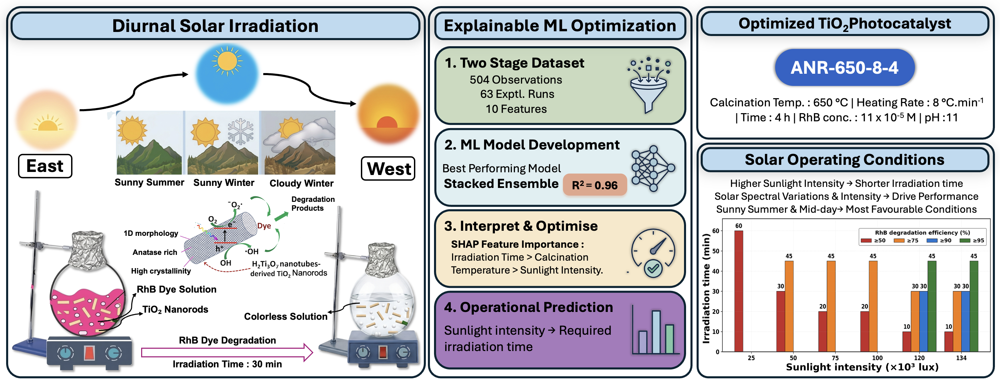

# TiO2-RhB-Photocatalysis-ML

Code and data for the paper:

> **Explainable Machine Learning for Prediction and Optimization of Photocatalytic Rhodamine B Degradation over Anatase TiO₂ Nanorods under Diurnal Sunlight Irradiation**
> Prathima Tanguturi Venkata, Pravenraam Shankar, Sanjhana Anandan, Anil Kumar Reddy Police, Chinna Gangi Reddy Nallagondu, Mamatha Kumari Murikinati, Vairamuthu Subbiah, Selva Rani Balasubramaniam, Sungjun Bae, Shankar Muthukonda Venkatakrishnan
> *Journal of Cleaner Production* (under review, manuscript JCLEPRO-D-26-27397)

The repository contains the full experimental dataset (Table S2) and the Python scripts (Table S4) that produce the models, tables and figures in the paper and its Supplementary Information.



## Overview

RhB decolorization over anatase TiO₂ nanorods was measured outdoors under natural sunlight at Yogi Vemana University, Kadapa, India. The data were collected in two stages and modelled separately:

| | Stage 1 | Stage 2 |
|---|---|---|
| Purpose | Catalyst synthesis and reaction conditions | Diurnal, seasonal and weather effects on the optimized catalyst (ANR-650-8-4) |
| Runs × time points | 39 runs × 8 | 24 runs × 8 |
| Observations | 312 | 192 |
| Model inputs | F1-F3, F8-F12 (8 inputs) | F8, F9, F10 (3 inputs) |
| Target | Decolorization efficiency at 554 nm, % | Decolorization efficiency at 554 nm, % |

In total that is 504 observations from 63 runs. A further 80 observations from 10 repeatability, reproducibility and reusability runs (rows 8a-10d in Sheet 1) are kept out of training and used only for external validation. These runs all use ANR-650-8-4 at the optimized condition, so they test repeat experiments rather than new conditions.

### Feature codes

Feature codes follow Table S3 of the paper. F9 and F10 mean different things in the two stages. The scripts use descriptive column names:

| Code (paper) | Description | Column name in code | How it enters the model |
|---|---|---|---|
| **Stage 1** | | | |
| F1 | Calcination temperature (°C) | `F1_CalcTemp` | numeric |
| F2 | Calcination ramp (°C min⁻¹) | `F2_CalcRamp` | numeric |
| F3 | Calcination time (h) | `F3_CalcTime` | numeric |
| F8 | Irradiation time (min) | `F8_TimeStep` | numeric |
| F9 | RhB concentration (×10⁻⁵ M) | `F9_RhBConc` | numeric |
| F10 | Solution pH | `F10_pH` | numeric |
| F11 | Co-existing ions | `F11_Ions` | total concentration in ppm: 0 none, 20 cation mix, 30 anion mix, 50 combined |
| F12 | Radical scavenger | `F12_Scavengers` | numeric code from Table S3: 0 none, 6 e⁻, 7 h⁺, 8 O₂•⁻, 9 •OH |
| **Stage 2** | | | |
| F8 | Irradiation time (min) | `F8_TimeStep` | numeric |
| F9 | Average sunlight intensity (lux) | `SunlightLux` | numeric |
| F10 | Ambient temperature (°C) | `Temperature_C` | numeric |

F11 and F12 are used as plain numbers. Tree models split on these values directly; for SVR, GPR and KNN the scavenger codes impose an order that has no physical meaning. F4-F7 (crystal phase, crystallite size, crystallinity, morphology) are kept in the dataset for reference but are not model inputs; they are written out as `07_catalyst_characterisation.csv`.

### Models

Nine regressors are compared for each stage: XGBoost, LightGBM, Gradient Boosting, Random Forest, Extra Trees, SVR (RBF), Gaussian process, KNN and a stacked ensemble. The stacked ensemble is a Ridge meta-learner fitted on the out-of-fold predictions of the eight base models. Hyperparameters are fixed values (no search); all of them are listed in `outputs/tables/17_hyperparameters.csv`. Inputs are standardized only inside the SVR and KNN pipelines (the scaler is fitted on the training folds); for the Gaussian process only the target is standardized. Tree models use unscaled inputs. For LightGBM, `subsample` has no effect because `subsample_freq` is left at 0.

Which fitted model is used for each analysis:

| Analysis | Model |
|---|---|
| Cross-validated comparison, residuals (Fig. 2a-f, Fig. 6a-d, Fig. S1-S2) | all nine models, including the stacked ensemble |
| Learning curves (Fig. 2g) | stacked ensemble |
| External validation on the 80 held-out rows | Stage 1 XGBoost |
| SHAP (Fig. 3, Fig. S4) | Stage 1 XGBoost, Stage 2 Extra Trees (TreeExplainer) |
| Design map, temperature response, sensitivity, DE, stress scenarios (Fig. 4b, 5, 6e-f, 7) | Stage 1 XGBoost |
| Deployment curves and nomogram (Fig. 8) | Stage 2 XGBoost, temperature fixed at 32 °C |
| t₅₀ box plots (Fig. 9) | measured t₅₀ (linear interpolation of each run, no model) |
| Counterfactual Case A vs Case B (Fig. 10) | Random Forest trained on the 22 measured t₅₀ values (inputs: sunlight intensity, temperature, hour; leave-one-out R² = 0.54) |

The stacked ensemble is evaluated by cross-validation only and is not saved as a single fitted model, so the downstream analyses use XGBoost, the best single model.

## Repository structure

```
TiO2-RhB-Photocatalysis-ML/
├── data/
│   └── ANR_TiO2_RhB_dataset.xlsx      # full experimental dataset (Table S2)
├── src/
│   ├── 01_linked_ml_pipeline.py       # cleaning, model comparison, external validation, SHAP, final models
│   ├── 02_learning_curves.py          # stacked-ensemble learning curves
│   ├── 03_chemistry_figures.py        # design map, sensitivity, DE, nomogram, stress scenarios, correlations
│   ├── 04_stage2_t50_analysis.py      # t50 extraction, t50 models, counterfactual
│   ├── project_style.py               # shared plotting style
│   ├── run_all.py                     # runs steps 01-04 in order
│   └── check_outputs.py               # compares new tables with reference/tables
├── outputs/
│   ├── tables/                        # CSV / JSON results
│   ├── figures/                       # figures (300 DPI PNG)
│   └── models/final_models_v3.pkl     # fitted Stage 1 and Stage 2 XGBoost models
├── reference/tables/                  # reference copies of the result tables
├── docs/graphical_abstract.png
├── requirements.txt
├── LICENSE
└── README.md
```

## Dataset

`data/ANR_TiO2_RhB_dataset.xlsx` is the Table S2 workbook:

| Sheet | Contents |
|---|---|
| `0.Fixed-Env.Vairables` | Fixed experimental constants |
| `1. ANR_02-06-2026 (Vari-Long)` | Stage 1 runs plus the repeatability / reproducibility / reusability runs |
| `(2) Fixed-Rxn.Vari` | Fixed reaction conditions for the Stage 2 runs |
| `2(a) ANR-23-05-2026 (SunInt)` | Stage 2 runs with measured sunlight intensity |
| `(3) Temperature` | Hourly ambient temperature for each Stage 2 day |

The scripts read the sheets by name, so please don't rename them. The 0 min rows are dropped during cleaning (see `01_data_cleaning_log.csv`).

## Installation

Tested with Python 3.12.

```bash
git clone https://github.com/<your-username>/TiO2-RhB-Photocatalysis-ML.git
cd TiO2-RhB-Photocatalysis-ML
python -m venv .venv
source .venv/bin/activate          # Windows: .venv\Scripts\activate
pip install -r requirements.txt
```

Use the pinned versions. In particular the results were produced with **XGBoost 3.3.0**: XGBoost 3.2 and older build slightly different trees from the same settings, which shifts the XGBoost-based numbers in the second or third decimal.

## Usage

From the repository root:

```bash
python src/run_all.py          # about 6 minutes; writes everything to outputs/
python src/check_outputs.py    # compares outputs/tables with reference/tables
```

`run_all.py` sets `STRIP_TITLES=1` (figures without descriptive titles, as in the paper) and `LC_SKIP=1` (step 01 skips its own quick learning curve; step 02 builds the one in the paper). Use `python src/run_all.py --skip-lc` to skip the learning-curve step.

Single steps can also be run on their own, in order (`01` must run before `02` and `03`). In `03_chemistry_figures.py` and `04_stage2_t50_analysis.py` only the figures used in the paper are built by default; set `ONLY=ALL` to build the exploratory figures as well, or for example `ONLY="fig_K"` for one figure.

All random seeds are fixed (`SEED = 42`). The only random element not tied to the seed is the vertical jitter of the points in `fig_T_t50_strata.png`.

## Where each paper figure comes from

| Paper figure | Output file(s) in `outputs/figures/` | Script |
|---|---|---|
| Fig. 2 (a-d) model comparison | `fig_03_model_comparison.png` | 01 |
| Fig. 2 (e,f) train-validation gap | `fig_08_train_test_gap.png` | 01 |
| Fig. 2 (g) learning curves | `fig_09_learning_curves.png` | 02 |
| Fig. 3 SHAP importance | `fig_06_shap_attribution.png` | 01 |
| Fig. 4 (a) measured ion / scavenger suppression | `fig_D_interference.png` | 03 |
| Fig. 4 (b) stress scenarios at 15 / 30 / 60 min | `fig_N_counterfactual_stress.png` | 03 |
| Fig. 5 (a) calcination temperature × time map | `fig_I_synthesis_surface.png` | 03 |
| Fig. 5 (b) temperature response and crystallite size | `fig_B_temperature_response.png` | 03 |
| Fig. 6 (a-d) residuals | `fig_07_residual_diagnostics.png` | 01 |
| Fig. 6 (e,f) DE optimization | `fig_J_cross_stage_bridge.png` | 03 |
| Fig. 7 (a-c) repeatability / reproducibility / reusability | `fig_04_stability_validation.png` | 01 |
| Fig. 7 (d-k) one-at-a-time sensitivity | `fig_K_OAT_response_surfaces.png` | 03 |
| Fig. 8 (a) Stage 2 deployment | `fig_05_stage2_lux_temp.png` | 01 |
| Fig. 8 (b) nomogram | `fig_M_time_to_target_nomogram.png` | 03 |
| Fig. 8 (c) nomogram bars | `fig_M2_nomogram_bars.png` | 03 |
| Fig. 9 t₅₀ by time of day, season and weather | `fig_T_t50_strata.png` | 04 |
| Fig. 10 counterfactual attribution | `fig_V_caseAB_comparison.png` | 04 |
| Fig. S1, S2 parity plots | `fig_01_stage1_parity.png`, `fig_02_stage2_parity.png` | 01 |
| Fig. S3 Pearson correlation | `fig_R_pearson_heatmap.png`, `fig_R2_pearson_heatmap_stage2.png` | 03 |
| Fig. S4 SHAP dependence | `fig_X_shap_dependence.png` | 03 |

`fig_W_recommendations.png` and `fig_Y_stage2_temp_surfaces.png` are extra figures that are not in the paper.

## Main tables

| File | Contents |
|---|---|
| `01_data_cleaning_log.csv` | Rows removed or modified during cleaning |
| `02_stage1_metrics.csv`, `03_stage2_metrics.csv` | Repeated 5-fold and run-grouped CV metrics for all nine models, with in-fold train R² |
| `04_stability_RSD.csv` | Measured reproducibility (RSD) of the repeat runs |
| `05_holdout_validation.csv` | Repeated 80/20 random and run-grouped hold-out tests |
| `06_shap_stage1.csv`, `06_shap_stage2.csv` | Mean absolute SHAP value per feature |
| `07_catalyst_characterisation.csv` | Calcination recipe vs measured catalyst properties (F4-F7) |
| `08`, `09` | Catalyst ranking, measured ion / scavenger interference |
| `11_linking_validation_v3.json`, `18_de_optimum_plateau.csv` | DE result, and the size of the predicted 100 % plateau around it |
| `12_counterfactual_stress_test.csv` | Stage 1 predictions for the stress scenarios |
| `14_t50_dataset.csv`, `15_t50_model_comparison.csv` | Measured t₂₅-t₁₀₀ per run, t₅₀ model comparison |
| `16_external_validation.csv` | External validation on the 80 held-out rows, overall and per run |
| `17_hyperparameters.csv` | Hyperparameters and input scaling of every model (Table S5) |

## Results summary

Two cross-validation schemes are reported for every model:

- **Repeated 5-fold:** random splits. Time points from the same run can sit in both training and validation folds, so this measures interpolation within the tested conditions.
- **Run-grouped 10-fold (GroupKFold):** all 8 time points of a run stay in the same fold (about 4 runs per fold in Stage 1, 2-3 in Stage 2). This is the more realistic estimate for an untested condition, and the scores are much lower, especially for Stage 1.

| Model | Stage | Repeated 5-fold R² | MAE (%) | Run-grouped R² | MAE (%) |
|---|---|---|---|---|---|
| Stacked ensemble | 1 | 0.958 | 4.29 | 0.343 | 16.91 |
| Stacked ensemble | 2 | 0.979 | 3.05 | 0.779 | 10.29 |
| XGBoost | 1 | 0.951 | 4.64 | 0.447 | 14.05 |
| XGBoost | 2 | 0.966 | 4.05 | 0.779 | 10.70 |

Across all nine models, run-grouped R² is 0.34-0.53 in Stage 1 and 0.77-0.82 in Stage 2, except the Gaussian process in Stage 2 (−0.01).

External validation (Stage 1 XGBoost, 80 held-out rows): R² = 0.98, MAE = 2.53 %.

Differential evolution on the Stage 1 XGBoost model (calcination temperature 550-750 °C, ramp 2-10 °C min⁻¹, time 1-5 h; 60 min; RhB 11 × 10⁻⁵ M, pH 11, no ions or scavengers; `scipy.optimize.differential_evolution`, best1bin, popsize 25, 300 generations, seed 42) returns 664 °C, 9.0 °C min⁻¹, 3.4 h with a predicted 100 %. The prediction is capped at 100 % and is flat over a wide region (550-690 °C on the search grid) that also contains ANR-650-8-4, so the exact optimum point is not unique; `18_de_optimum_plateau.csv` gives the extent of this region.

## A note on SHAP

SHAP values describe how the trained model uses each input. They are a model attribution and not, on their own, evidence of a physical mechanism.

## Citation

If you use this code or data, please cite the paper. Full citation details will be added once it is published.

```bibtex
@article{tanguturivenkata2026anr,
  title   = {Explainable Machine Learning for Prediction and Optimization of Photocatalytic Rhodamine B Degradation over Anatase TiO2 Nanorods under Diurnal Sunlight Irradiation},
  author  = {Tanguturi Venkata, Prathima and Shankar, Pravenraam and Anandan, Sanjhana and Police, Anil Kumar Reddy and Nallagondu, Chinna Gangi Reddy and Murikinati, Mamatha Kumari and Subbiah, Vairamuthu and Balasubramaniam, Selva Rani and Bae, Sungjun and Muthukonda Venkatakrishnan, Shankar},
  journal = {Journal of Cleaner Production},
  year    = {2026},
  note    = {Under review}
}
```

## License

The code is released under the MIT License (see `LICENSE`). If you reuse the dataset, please cite the paper.

## Contact

- Code: Pravenraam Shankar, School of Computer Science and Engineering, VIT Vellore. Please open an issue on this repository.
- Paper: Shankar Muthukonda Venkatakrishnan (corresponding author), shankar@yogivemanauniversity.ac.in
